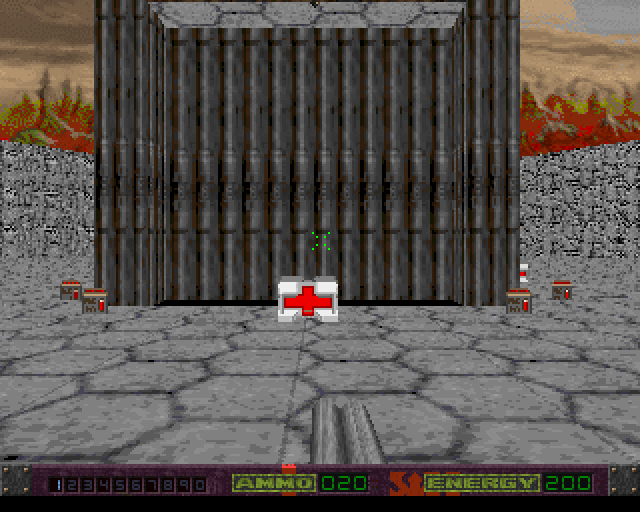
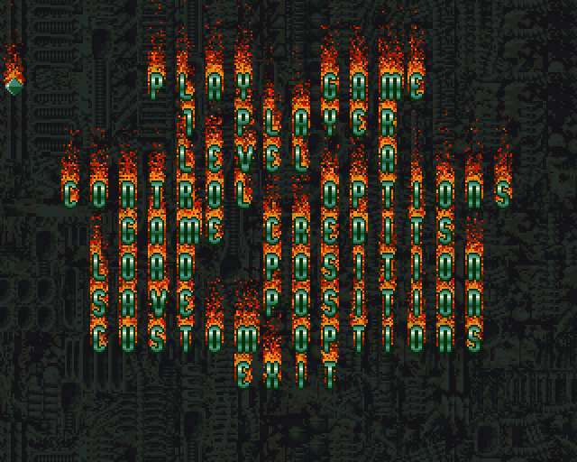
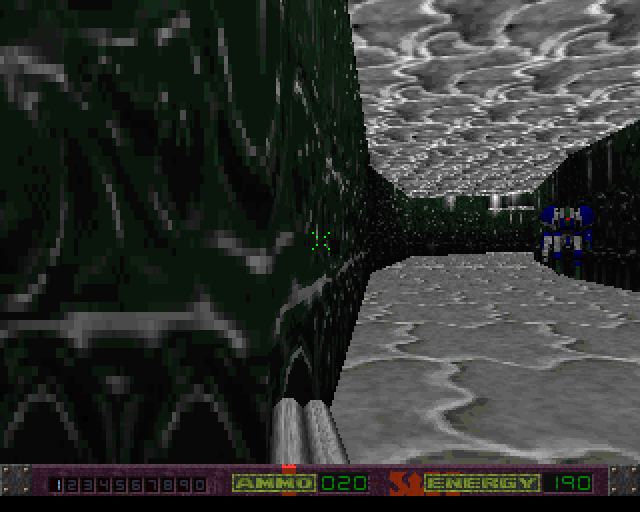
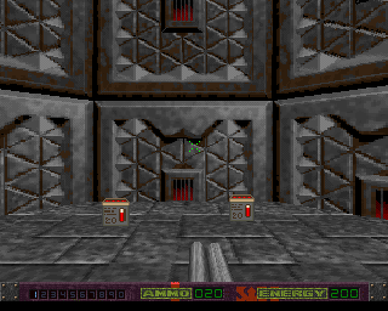
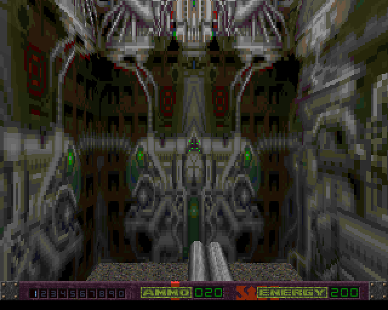
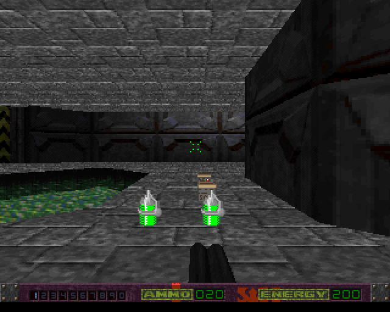
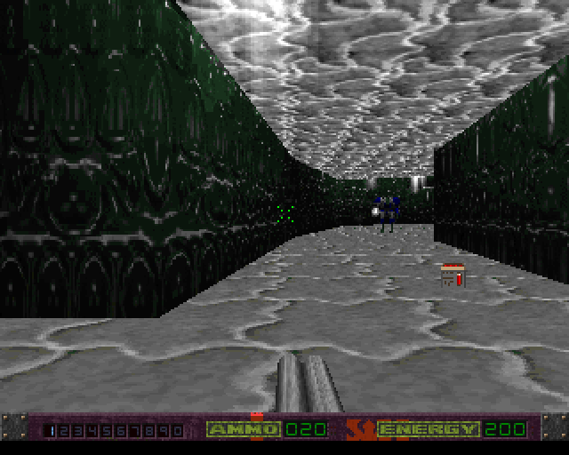
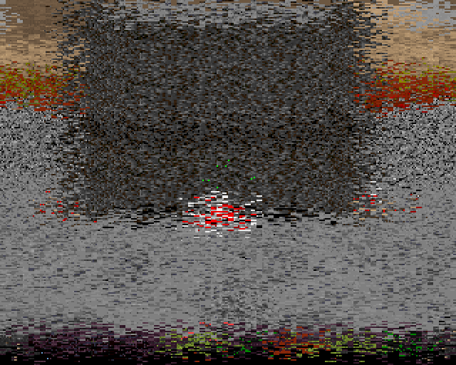

# AB3D2 Full Java — the conversion, not the translation

*[Version française](README_fr.md)*

The third reading of *Alien Breed 3D II: The Killing Grounds* (Team17, Amiga, 1996), after the
faithful port and the 3D remake. This one converts the original assembly into **real Java**:
classes, named fields, collections. No flat memory, no registers.

**The game is complete.** The menu, the sixteen levels in sequence, the saves, the rendering and
the sound — fifty frames per second. It builds into a portable Windows application and an
**Android APK**.



*Level O. Sky, floor shading, pickups, weapon in hand, status panel — all of it
is painted by this repository, pixel by pixel, in plain Java.*

---

## The three readings

| repository | what it is |
| --- | --- |
| [**ab3d2-tkg-java**](https://github.com/guillaumemonet/ab3d2-tkg-java) | the **literal port**: the assembly translated instruction by instruction, flat 68000 RAM, simulated registers. It is the **oracle**. |
| [**ab3d2-tkg-rebirth**](https://github.com/guillaumemonet/ab3d2-tkg-rebirth) | the full 3D **remake** on jMonkeyEngine, which allows itself to diverge. It also hosts the extractors that produce the reference corpus. |
| **ab3d2-tkg-full-java** *(here)* | the **object conversion**: the original mechanics, exactly, but written the way one would write them today. |

The port reads like assembly written in Java, and every field in it is a number. The remake
goes to the other extreme. Here, the middle way: a sector is an object with a floor, a ceiling
and edges, not an offset into a block of bytes.

When a rule is in doubt, it is settled against the port — and if need be against the
original assembly.

---

## The rules

1. **No flat memory.** No `Mem`, no global addresses. Each original file is
   read by a local byte reader and becomes objects.
2. **No register emulation.** No instruction loop, no flags.
3. **A single concession, deliberate and isolated**: `M68k`. The original algorithms *depend* on
   16-bit truncation, on writing a word into a 32-bit register, and on the fact that an
   impossible division leaves the register **unchanged** instead of throwing an exception. Changing
   that changes the trajectories, not just the rounding.
4. **Names, not numbers.** `zone.floor()`, not `Mem.l(z + 2)`.
5. **Immutable for the level, mutable for the game state.** The file says what is placed and where,
   once and for all; what changes lives elsewhere.
6. **No dependencies.** Gson is only used by the validation tools; the game itself imports
   nothing but the JDK.

---

## In pictures



*The menu, and its fire. It is not a cellular automaton but **three Amiga blitter blits
per frame**, `D = A_décalé | (B & C)`, where `A` is a plane of the **font**: that is why
the text burns. Checked plane by plane against the port.*



*The monsters are not extras: this one walked up to the player and hit him —
energy dropped to 185. The AI, the trajectories and the damage are those of 1996, checked
frame by frame against the port.*




*Level E: sub-tiled walls, shaded floor, two ammo crates. Then level I, where
the texture covers the whole wall in a single piece.*




*Animated water and its loops; and a tunnel in level B, two monsters at the far end.*



*The level exit. The effect computes nothing: it **looks at the image askew**, through a
table of offsets. Eight steps, from almost sharp to unreadable.*

---

## Where things stand

| piece | status |
| --- | --- |
| reading the 16 levels | **done** — 0 mismatches |
| link database (`test.lnk`) | **done** — 0 mismatches |
| simulation: player, AI, shots, objects, doors, lifts | **done** |
| software rasteriser: walls, floors, sky, water, sprites, models | **done** |
| lighting: sectors, dynamic lamps, shading | **done** |
| status panel, weapon in hand, messages | **done** |
| audio: Paula engine, sound effects, music | **done** |
| playable game loop | **done** — `gradle game` |
| menu, fire, font, submenus | **done** — 0 mismatches |
| sequence of the sixteen levels | **done** |
| saves and settings | **done** |
| portable Windows release | **done** — `gradle packageApp` |
| Android release (APK) | **done** — `gradle apk` |
| intro story text | to do |
| two-player mode | to do |

About **41,300 lines** of Java, split as follows:

| package | files | lines | what it does |
| --- | ---: | ---: | --- |
| `level` | 11 | 2,249 | read a level: sectors, edges, textures, palettes, models |
| `defs` | 2 | 699 | the link database: weapons, monsters, objects |
| `sim` | 32 | 11,551 | the simulation: player, AI, shots, collisions, doors, the game session |
| `render` | 36 | 10,753 | the complete software rasteriser |
| `sound` | 7 | 2,355 | the Paula audio engine, the music player, the mixer |
| `menu` | 8 | 1,502 | the menu: the fire, the font, the pages, the saves |
| `boot` | 6 | 1,064 | the disks: mounting, unpacking, downloading |
| `view` | 10 | 2,328 | the window, the loop, the screenshot |
| `android` | 3 | 705 | the surface, the fingers, the `AudioTrack` |
| root | 36 | 8,090 | `M68k`, the byte readers, and the **36 checkers** |

---

## Playing

```bash
gradle game                   # the menu, then the game
gradle game -Plevel=c         # straight into a level, skipping the menu
gradle game -Pscale=4         # a bigger window
gradle game -Pmute            # without sound
```

On first launch, if it cannot find the data, the game **offers** to fetch the
five disks from [Dream17](https://dream17.abime.net), the preservation site for Team17's Amiga
catalogue. Nothing is downloaded without an explicit yes.

In the menu: **up** and **down** to choose, **ENTER** to confirm, **ESC** to
go back.

| key | action |
| --- | --- |
| arrows, **ZQSD** | walk |
| **A** / **E**, left and right arrows | turn |
| **SHIFT** + direction | sidestep |
| **CTRL** | run |
| **SPACE** | fire |
| **ALT** + **SPACE** | jump |
| **C** | crouch |
| **F** | operate — the key that opens locked doors |
| **1**–**9** | change weapon |

Two lighting settings, to see what the shading brings: `-Psimple` turns off the one on
walls, `-Pflatshade` the one on floors.

```bash
gradle shot -Plevel=o -Pzone=55 -Pangle=7168 -Pframes=30 -Pout=une_image.png
gradle shot -Pshimmer=5       # the same image, dematerialising
gradle menuShot -Pframes=120  # a frame of the menu (the text only arrives at the 35th)
gradle play -Plevel=c         # the simulation alone, seen from above
gradle unpack                 # unpack the disks by hand
```

---

## Packaging

```bash
gradle packageApp             # Windows: build/jpackage/AlienBreed3D2-TKG/
gradle apk                    # Android: build/android/ab3d2-tkg.apk
gradle installApk             # … and install it on the connected device
```

**Neither one contains any game data at all.** The Windows application is 152 MB
— that is the embedded JRE — and the APK **286 KB**. Both fetch the disks on first
launch, if asked to.

The Android release is built **without the Android plugin**: the SDK tools are enough, and this
repository still has no dependencies. Five steps, each one readable — `javac` against `android.jar`,
`d8`, `aapt2`, a zip, `apksigner`.

### What makes Android possible

Nothing in the game knows its platform. `render`, `sim`, `level`, `menu` and `boot`
import only `java.*`, and `view.Shell` takes one intent per frame and returns a byte
buffer. All that is left to write, per platform, is three things:

| | Windows | Android |
| --- | --- | --- |
| show the image | `BufferedImage` + Swing | `Bitmap` + `SurfaceView` |
| read the controls | keyboard | virtual stick, drag to aim |
| push the sound | `javax.sound` | `AudioTrack` |

The APK's `classes.dex` contains **209 game classes and not a single reference** to AWT,
Swing or `javax.sound`. That is the proof that the separation holds.

On Android, the left thumb places a **stick that appears wherever you put it down** — you play without
looking at your thumbs — and the right thumb turns and aims by dragging, like a mouse.

---

## Checking

```bash
gradle checkAll               # all 51 tasks, in one go
```

Each one can be run on its own. They fall into five families.

**The file and the simulation**

| task | what it tests |
| --- | --- |
| `levelCheck` | the 16 levels, field by field |
| `defsCheck` | the link database, field by field |
| `moveTest` `alienTest` `shotTest` | movement, AI, shooting, on the 16 levels |
| `moveCheck` | where `MoveObject` stops, slides, changes sector |
| `animsCheck` | doors and lifts, frame by frame |
| `objectLifeCheck` | the life of objects: the four families |
| `blastCheck` | the blast of an explosion: damage, knockback, flames |
| `hitCheck` | the hit: who a bullet strikes, and what it leaves them |
| `shootCheck` | instant-hit fire: the accuracy roll and the recoil |
| `bitsCheck` | the spray of bits an entity leaves when it dies |
| `worldTest` `gameTest` | the **whole** loop, a thousand frames on each level |

**The staging**

| task | what it tests |
| --- | --- |
| `xformCheck` | the view transform, point by point |
| `zoneOrderCheck` `zoneGraphCheck` | the drawing order of sectors |
| `clipCheck` `edgePvsCheck` `visEdgesCheck` | the drawing window, the per-edge PVS, the visible openings |

**The pixels**

| task | what it tests |
| --- | --- |
| `wallCheck` `flatCheck` | the projection of walls, floors and ceilings |
| `wallPaintCheck` `gourWallPaintCheck` | wall texture mapping, column by column |
| `flatPaintCheck` `gourFlatPaintCheck` | floor texture mapping, span by span |
| `waterPaintCheck` `skyCheck` | animated water and the sky |
| `lightCheck` | lighting, sector by sector and point by point |

**The things**

| task | what it tests |
| --- | --- |
| `objXformCheck` `spriteOrderCheck` | the rotation and sorting of objects |
| `bitmapCheck` `bitmapPaintCheck` `bitmapLitCheck` | the placement and the pixels of a sprite |
| `objAnimCheck` `alienAnimCheck` | the appearance: what an animation step shows |
| `glareCheck` `brightRingsCheck` | the shimmer, and the rings of light in sixteen directions |
| `modelPointsCheck` `modelFacesCheck` `modelEdgesCheck` `modelPixelsCheck` | the 3D models, from points to pixels |

**The rest**

| task | what it tests |
| --- | --- |
| `hudCheck` `gunHoldCheck` | the status panel, and where the weapon sits on each frame |
| `paulaCheck` `musicCheck` | the audio engine and the music player, register by register |
| `shimmerCheck` | the dematerialisation, pixel by pixel — 1,966,080 pixels |
| `menuCheck` | the menu: noise, background, font, fire and palette — 274,688 bytes |
| `campaignTest` | the game session: the exit, death, and what you carry over |

The simulation harnesses accept `-Plevel=a` (or `all`).

---

## How the checking works

This is the centrepiece of the project, and it deserves a word.

A conversion is not proven by rereading it. It is proven **differentially**, in three
steps:

1. a **probe** is placed in the literal port — a few lines that record what the original code
   actually computes, at the exact place where it computes it;
2. an **extractor**, in the remake, runs the port and writes the record out as JSON;
3. a **checker**, here, replays each case without flat memory and compares.

The comparison is not statistical: it is **exact**, field by field and pixel by pixel.
A single mismatch fails the task.

The corpus is built to bite. It does not hold convenient values but **edge
cases**: the distance at which a shot tips over, the angle at which a wall disappears, the seed that gives
exactly the limit value. Several families have been put through a **mutation campaign** —
the converted code is deliberately damaged, and any mutation that survives points to a hole in the corpus,
which then gets plugged.

It is this process that brought to light, in the original code, things you do not find by
reading: a word multiplication that overflows in the vertical aiming filter, a model's
representative point that refers to an index outside the model and reads what the previous object
left in the work table, an inverted view flag. None of them is fixed: **we port what
the game does, not what it should have done.**

---

## The data

Nothing is invented, and nothing executable is supplied. Two origins, two roots.

- `medias/original/` — what comes from the five disks: the levels and `Includes/test.lnk`.
  The game can produce them itself, by mounting the `.adf` images and unpacking what is
  packed; it offers to download them if it cannot find them.
- `data/incbin/` — the tables the assembly built into the executable. The sine table is
  one of them, and it is **read** rather than recomputed: the trajectories depend on its
  rounding. They travel **inside the archive**, because an installed application has no
  current directory that means anything, and a phone has no directory at all.

The reference corpus is the one the remake extracts. If the reading **without flat memory**
finds the same values, the conversion is right.

---

## Building

JDK 21 and Gradle. No other dependency for the game — Gson is only used by the checkers.

```bash
gradle build
gradle game
```

For the APK, you also need an Android SDK (found through `ANDROID_HOME`, or at its usual
location) with *build-tools* and a platform installed. The code targets **API 26**
(Android 8): data reading goes through `java.nio.file`, which the system only exposes from
that version on.

---

## Legal Notice & Game Assets

### Independent Engine Implementation

This project is an independent reimplementation of the *Alien Breed 3D II: The Killing Grounds* engine, designed to reproduce the original game's behavior on modern platforms.

The engine has been developed from the original source code (68000 assembly and C), as published in [mheyer32/alienbreed3d2](https://github.com/mheyer32/alienbreed3d2), through technical analysis and compatibility testing. That source code is not included in this repository: it is converted to Java.

### Original Game Files

This project requires original game files, such as the game's five Amiga ADF disk images, to run.

**Original game files are not included in this project.**

Users must obtain and provide their own game files from a legally authorized source. Before downloading or using this engine, users are required to confirm that they possess a legally obtained copy of the original game.

The game offers to download them when it cannot find them. Only the tables the assembler compiled into the executable (`data/incbin/`) travel with the code.

Eloane Studio does not host, distribute, or provide unauthorized copies of copyrighted game assets.

### Copyright & Trademarks

All original game names, trademarks, graphics, music, and other proprietary assets of *Alien Breed 3D II: The Killing Grounds* remain the property of their respective copyright holders (Team17).

This project is an independent, unofficial implementation and is not affiliated with, endorsed by, or sponsored by the original game's developers or publishers.

### Preservation

The purpose of this project is to preserve the technical behavior and gameplay experience of classic video games while making them accessible on modern systems.

The engine is provided for compatibility, preservation, and educational purposes.

### Credits

Original engine: Team17 (Andy Clitheroe et al.). Reference ASM/C sources: [mheyer32/alienbreed3d2](https://github.com/mheyer32/alienbreed3d2). Java conversion: **Guillaume Monet**.
