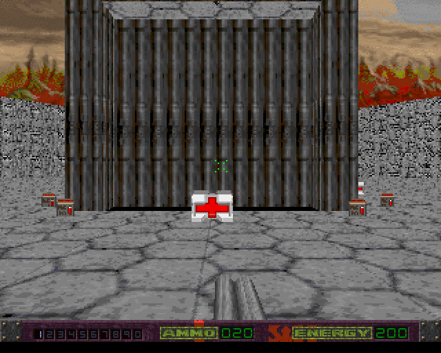
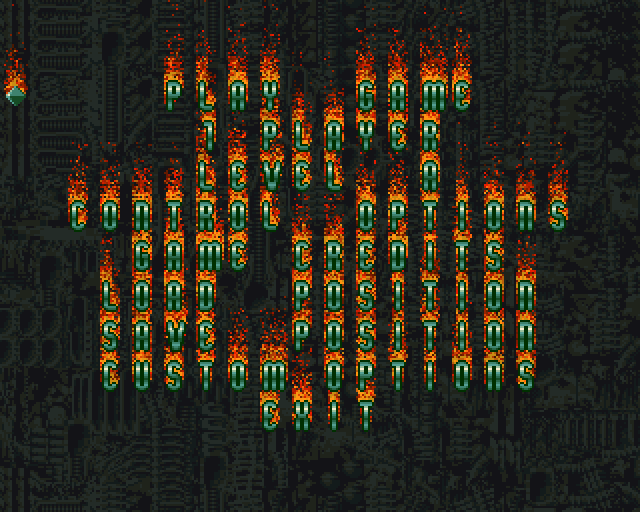
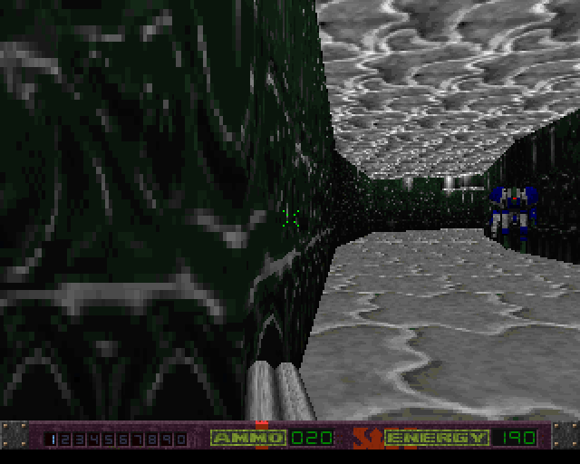
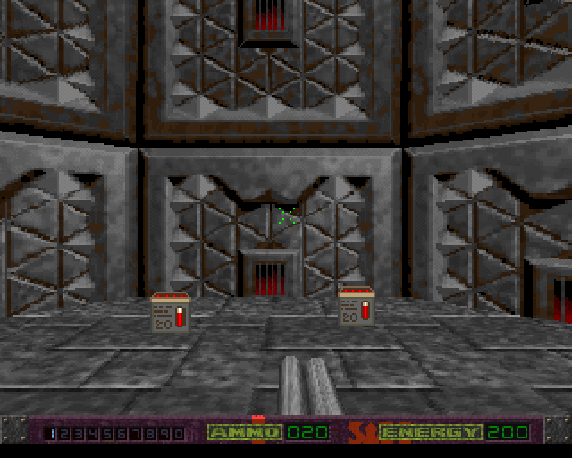
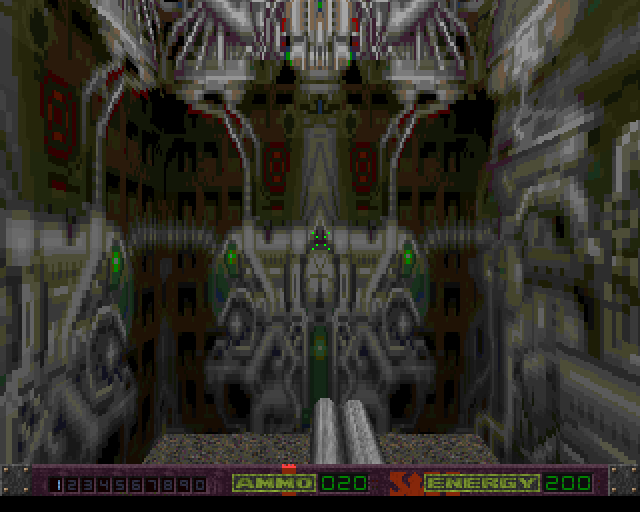
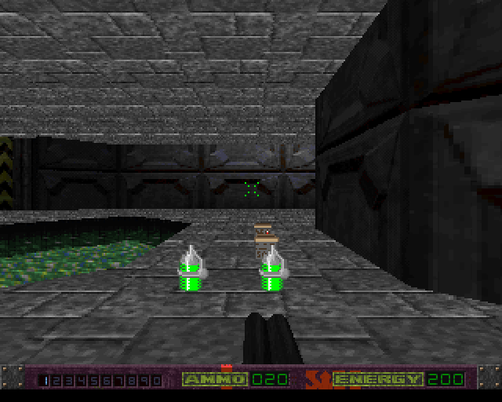
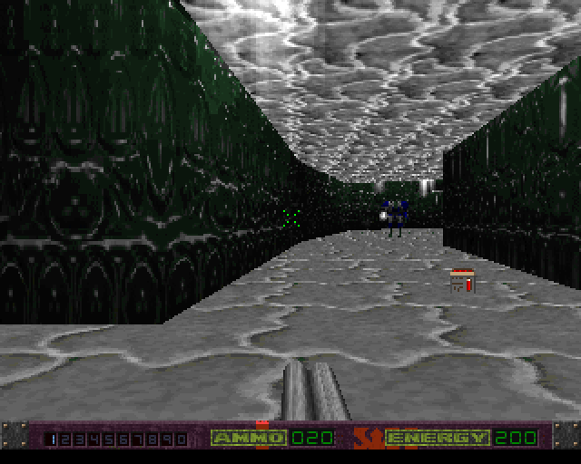
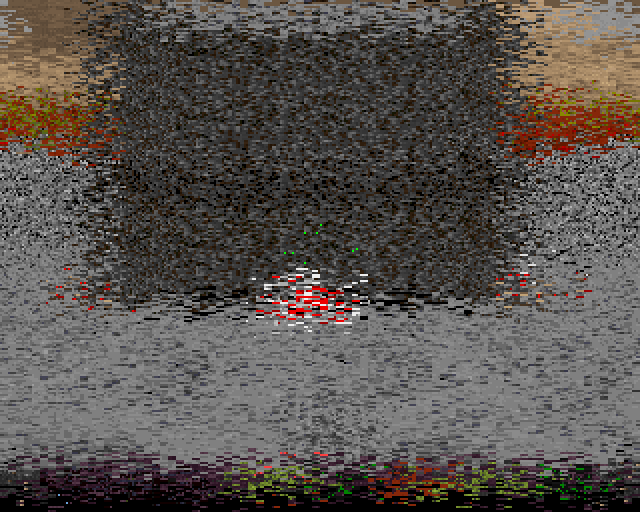

# AB3D2 Full Java — la conversion, pas la traduction

Troisième lecture d'*Alien Breed 3D II : The Killing Grounds* (Team17, Amiga, 1996), après le
portage fidèle et le remake 3D. Celle-ci convertit l'assembleur d'origine en **vrai Java** :
des classes, des champs nommés, des collections. Pas de mémoire plate, pas de registres.

**Le jeu est complet.** Le menu, les seize niveaux à la suite, les sauvegardes, le rendu et
le son — cinquante images par seconde. Il se construit en application Windows portable et en
**APK Android**.



*Le niveau O. Ciel, dégradé du sol, objets à ramasser, arme en main, tableau de bord — tout cela
est peint par ce dépôt, pixel par pixel, en Java ordinaire.*

---

## Les trois lectures

| dépôt | ce que c'est |
| --- | --- |
| [**ab3d2-tkg-java**](https://github.com/guillaumemonet/ab3d2-tkg-java) | le **portage littéral** : l'assembleur traduit instruction par instruction, RAM plate de 68000, registres simulés. C'est l'**oracle**. |
| [**ab3d2-tkg-rebirth**](https://github.com/guillaumemonet/ab3d2-tkg-rebirth) | le **remake** full 3D sous jMonkeyEngine, qui s'autorise à s'écarter. Il héberge aussi les extracteurs qui produisent le corpus de référence. |
| **ab3d2-tkg-full-java** *(ici)* | la **conversion objet** : les mécaniques d'origine, exactement, mais écrites comme on les écrirait aujourd'hui. |

Le portage se lit comme de l'assembleur écrit en Java, et chaque champ y est un nombre. Le remake
prend l'autre extrême. Ici, la voie du milieu : un secteur est un objet avec un sol, un plafond
et des arêtes, pas un offset dans un bloc d'octets.

Quand une règle est douteuse, c'est contre le portage qu'on tranche — et au besoin contre
l'assembleur d'origine.

---

## Les règles

1. **Aucune mémoire plate.** Pas de `Mem`, pas d'adresses globales. Chaque fichier d'origine est
   lu par un lecteur d'octets local et devient des objets.
2. **Aucune émulation de registres.** Pas de boucle d'instructions, pas de drapeaux.
3. **Une seule concession, assumée et isolée** : `M68k`. Les algorithmes d'origine *dépendent* de
   la troncature à 16 bits, de l'écriture d'un mot dans un registre de 32, et du fait qu'une
   division impossible laisse le registre **inchangé** au lieu de lever une exception. Changer
   cela change les trajectoires, pas seulement les arrondis.
4. **Des noms, pas des nombres.** `zone.floor()`, pas `Mem.l(z + 2)`.
5. **Immuable pour le niveau, mutable pour l'état de jeu.** Le fichier dit ce qui est posé et où,
   une fois pour toutes ; ce qui change vit ailleurs.
6. **Aucune dépendance.** Gson ne sert qu'aux outils de validation ; le jeu lui-même n'importe
   rien d'autre que le JDK.

---

## En images



*Le menu, et son feu. Ce n'est pas un automate cellulaire mais **trois blits du blitter Amiga
par image**, `D = A_décalé | (B & C)`, où `A` est un plan de la **police** : c'est pour cela que
le texte brûle. Vérifié plan par plan contre le portage.*



*Les monstres ne sont pas des figurants : celui-ci a marché jusqu'au joueur et l'a touché —
l'énergie est tombée à 185. L'IA, les trajectoires et les dégâts sont ceux de 1996, vérifiés
image par image contre le portage.*




*Le niveau E : murs à sous-tuiles, sol dégradé, deux caisses de munitions. Puis le niveau I, où
la texture couvre le mur entier d'un seul tenant.*




*L'eau animée et ses boucles ; et un tunnel du niveau B, deux monstres au fond.*



*La sortie du niveau. L'effet ne calcule rien : il **regarde l'image de travers**, à travers une
table de décalages. Huit pas, du presque net à l'illisible.*

---

## Où en est-on

| morceau | état |
| --- | --- |
| lecture des 16 niveaux | **fait** — 0 écart |
| base de liaison (`test.lnk`) | **fait** — 0 écart |
| simulation : joueur, IA, tirs, objets, portes, ascenseurs | **fait** |
| rastériseur logiciel : murs, sols, ciel, eau, sprites, modèles | **fait** |
| éclairage : secteurs, lampes dynamiques, dégradés | **fait** |
| tableau de bord, arme en main, messages | **fait** |
| audio : moteur Paula, bruitages, musique | **fait** |
| boucle de jeu jouable | **fait** — `gradle game` |
| menu, feu, police, sous-menus | **fait** — 0 écart |
| enchaînement des seize niveaux | **fait** |
| sauvegardes et réglages | **fait** |
| release Windows portable | **fait** — `gradle packageApp` |
| release Android (APK) | **fait** — `gradle apk` |
| texte narratif d'intro | à faire |
| mode deux joueurs | à faire |

Environ **41 300 lignes** de Java, réparties ainsi :

| paquet | fichiers | lignes | ce qu'il fait |
| --- | ---: | ---: | --- |
| `level` | 11 | 2 249 | lire un niveau : secteurs, arêtes, textures, palettes, modèles |
| `defs` | 2 | 699 | la base de liaison : armes, monstres, objets |
| `sim` | 32 | 11 551 | la simulation : joueur, IA, tirs, collisions, portes, la partie |
| `render` | 36 | 10 753 | le rastériseur logiciel au complet |
| `sound` | 7 | 2 355 | le moteur audio Paula, le lecteur de musique, le mélangeur |
| `menu` | 8 | 1 502 | le menu : le feu, la police, les pages, les sauvegardes |
| `boot` | 6 | 1 064 | les disquettes : montage, dépackage, téléchargement |
| `view` | 10 | 2 328 | la fenêtre, la boucle, la prise d'image |
| `android` | 3 | 705 | la surface, les doigts, l'`AudioTrack` |
| racine | 36 | 8 090 | `M68k`, les lecteurs d'octets, et les **36 vérificateurs** |

---

## Jouer

```bash
gradle game                   # le menu, puis le jeu
gradle game -Plevel=c         # tout de suite un niveau, sans passer par le menu
gradle game -Pscale=4         # une fenêtre plus grande
gradle game -Pmute            # sans le son
```

Au premier lancement, s'il ne trouve pas les données, le jeu **propose** d'aller chercher les
cinq disquettes chez [Dream17](https://dream17.abime.net), le site de préservation du catalogue
Amiga de Team17. Rien n'est téléchargé sans un oui explicite.

Dans le menu : **haut** et **bas** pour choisir, **ENTRÉE** pour valider, **ÉCHAP** pour
reculer.

| touche | action |
| --- | --- |
| flèches, **ZQSD** | marcher |
| **A** / **E**, flèches gauche et droite | tourner |
| **MAJ** + direction | pas de côté |
| **CTRL** | courir |
| **ESPACE** | tirer |
| **ALT** + **ESPACE** | sauter |
| **C** | s'accroupir |
| **F** | actionner — la touche qui ouvre les portes à serrure |
| **1**–**9** | changer d'arme |

Deux réglages d'éclairage, pour voir ce que le dégradé apporte : `-Psimple` éteint celui des
murs, `-Pflatshade` celui des sols.

```bash
gradle shot -Plevel=o -Pzone=55 -Pangle=7168 -Pframes=30 -Pout=une_image.png
gradle shot -Pshimmer=5       # la même image, en train de se dématérialiser
gradle menuShot -Pframes=120  # une image du menu (le texte n'arrive qu'à la 35e)
gradle play -Plevel=c         # la simulation seule, vue de dessus
gradle unpack                 # dépaquer les disquettes à la main
```

---

## Empaqueter

```bash
gradle packageApp             # Windows : build/jpackage/AlienBreed3D2-TKG/
gradle apk                    # Android : build/android/ab3d2-tkg.apk
gradle installApk             # … et le poser sur l'appareil branché
```

**Ni l'une ni l'autre ne contient la moindre donnée du jeu.** L'application Windows fait 152 Mo
— c'est le JRE embarqué — et l'APK **286 Ko**. Les deux vont chercher les disquettes au premier
lancement, si on le leur demande.

La release Android se construit **sans le plugin Android** : les outils du SDK suffisent, et ce
dépôt n'a toujours aucune dépendance. Cinq pas, chacun lisible — `javac` contre `android.jar`,
`d8`, `aapt2`, un zip, `apksigner`.

### Ce qui rend l'Android possible

Rien, dans le jeu, ne connaît sa plateforme. `render`, `sim`, `level`, `menu` et `boot`
n'importent que `java.*`, et `view.Shell` prend une intention par image et rend un tampon
d'octets. Il ne reste à écrire, par plateforme, que trois choses :

| | Windows | Android |
| --- | --- | --- |
| montrer l'image | `BufferedImage` + Swing | `Bitmap` + `SurfaceView` |
| lire les commandes | clavier | stick virtuel, glisser pour viser |
| pousser le son | `javax.sound` | `AudioTrack` |

Le `classes.dex` de l'APK contient **209 classes du jeu et pas une seule référence** à AWT, à
Swing ou à `javax.sound`. C'est la preuve que la séparation tient.

Sur Android, le pouce gauche pose un **stick qui naît là où on le pose** — on joue sans
regarder ses pouces — et le pouce droit tourne et vise au glissement, comme une souris.

---

## Vérifier

```bash
gradle checkAll               # les 51 tâches, d'un coup
```

Chacune se lance seule. Elles tombent en cinq familles.

**Le fichier et la simulation**

| tâche | ce qu'elle éprouve |
| --- | --- |
| `levelCheck` | les 16 niveaux, champ par champ |
| `defsCheck` | la base de liaison, champ par champ |
| `moveTest` `alienTest` `shotTest` | le déplacement, l'IA, le tir, sur les 16 niveaux |
| `moveCheck` | où `MoveObject` arrête, fait glisser, change de secteur |
| `animsCheck` | les portes et les ascenseurs, image par image |
| `objectLifeCheck` | la vie des objets : les quatre familles |
| `blastCheck` | le souffle d'une explosion : dégâts, reculs, flammes |
| `hitCheck` | le coup au but : qui une balle touche, et ce qu'elle lui laisse |
| `shootCheck` | le tir instantané : le dé de précision et le recul |
| `bitsCheck` | la gerbe de morceaux qu'une entité laisse en mourant |
| `worldTest` `gameTest` | la boucle **entière**, mille images sur chaque niveau |

**La mise en scène**

| tâche | ce qu'elle éprouve |
| --- | --- |
| `xformCheck` | la transformation de vue, point par point |
| `zoneOrderCheck` `zoneGraphCheck` | l'ordre de dessin des secteurs |
| `clipCheck` `edgePvsCheck` `visEdgesCheck` | la fenêtre de dessin, le PVS par arête, les ouvertures visibles |

**Les pixels**

| tâche | ce qu'elle éprouve |
| --- | --- |
| `wallCheck` `flatCheck` | la projection des murs, des sols et des plafonds |
| `wallPaintCheck` `gourWallPaintCheck` | le placage des murs, colonne par colonne |
| `flatPaintCheck` `gourFlatPaintCheck` | le placage des sols, tranche par tranche |
| `waterPaintCheck` `skyCheck` | l'eau animée et le ciel |
| `lightCheck` | l'éclairage, secteur par secteur et point par point |

**Les choses**

| tâche | ce qu'elle éprouve |
| --- | --- |
| `objXformCheck` `spriteOrderCheck` | la rotation et le tri des objets |
| `bitmapCheck` `bitmapPaintCheck` `bitmapLitCheck` | la pose et les pixels d'un sprite |
| `objAnimCheck` `alienAnimCheck` | l'apparence : ce qu'un pas d'animation donne à voir |
| `glareCheck` `brightRingsCheck` | le miroitement, et les anneaux de lumière en seize directions |
| `modelPointsCheck` `modelFacesCheck` `modelEdgesCheck` `modelPixelsCheck` | les modèles en relief, des points aux pixels |

**Le reste**

| tâche | ce qu'elle éprouve |
| --- | --- |
| `hudCheck` `gunHoldCheck` | le tableau de bord, et où l'arme se pose à chaque image |
| `paulaCheck` `musicCheck` | le moteur audio et le lecteur de musique, registre par registre |
| `shimmerCheck` | la dématérialisation, pixel par pixel — 1 966 080 pixels |
| `menuCheck` | le menu : bruit, fond, police, feu et palette — 274 688 octets |
| `campaignTest` | la partie : la sortie, la mort, et ce qu'on emporte |

Les harnais de simulation acceptent `-Plevel=a` (ou `all`).

---

## Comment on vérifie

C'est la pièce maîtresse du projet, et elle mérite un mot.

Une conversion ne se prouve pas en la relisant. Elle se prouve **différentiellement**, en trois
temps :

1. une **sonde** est posée dans le portage littéral — quelques lignes qui relèvent ce que le code
   d'origine calcule vraiment, à l'endroit exact où il le calcule ;
2. un **extracteur**, dans le remake, fait tourner le portage et écrit le relevé en JSON ;
3. un **vérificateur**, ici, rejoue chaque cas sans mémoire plate et compare.

La comparaison n'est pas statistique : elle est **exacte**, champ par champ et pixel par pixel.
Un seul écart fait échouer la tâche.

Le corpus est construit pour mordre. On n'y met pas des valeurs commodes mais des **cas aux
bornes** : la distance où le tir bascule, l'angle où un mur disparaît, la graine qui donne
exactement la valeur limite. Plusieurs familles ont été soumises à une **campagne de mutation** —
on abîme volontairement le code converti, et toute mutation qui survit signale un trou du corpus,
qu'on bouche.

C'est ce procédé qui a mis au jour, dans le code d'origine, des choses qu'on ne trouve pas en
lisant : une multiplication de mots qui déborde dans le filtre de visée verticale, un point
représentatif de modèle qui désigne un rang hors du modèle et lit ce que l'objet précédent a
laissé dans la table de travail, un drapeau de vue inversé. Aucune n'est corrigée : **on porte ce
que le jeu fait, pas ce qu'il aurait dû faire.**

---

## Les données

Rien n'est inventé, et rien d'exécutable n'est fourni. Deux provenances, deux racines.

- `medias/original/` — ce qui vient des cinq disquettes : les niveaux et `Includes/test.lnk`.
  Le jeu sait les produire lui-même, en montant les images `.adf` et en dépaquant ce qui
  l'est ; il propose de les télécharger s'il ne les trouve pas.
- `data/incbin/` — les tables que l'assembleur incorporait à l'exécutable. La table de sinus en
  fait partie, et on la **lit** plutôt que de la recalculer : les trajectoires dépendent de ses
  arrondis. Elles voyagent **dans l'archive**, parce qu'une application installée n'a pas de
  dossier courant qui veuille dire quelque chose, et un téléphone pas de dossier du tout.

Le corpus de référence est celui qu'extrait le remake. Si la lecture **sans mémoire plate**
retrouve les mêmes valeurs, c'est que la conversion est juste.

---

## Construire

JDK 21 et Gradle. Aucune autre dépendance pour le jeu — Gson ne sert qu'aux vérificateurs.

```bash
gradle build
gradle game
```

Pour l'APK, il faut en plus un SDK Android (trouvé par `ANDROID_HOME`, ou à son emplacement
habituel) avec des *build-tools* et une plateforme installés. Le code vise l'**API 26**
(Android 8) : la lecture des données passe par `java.nio.file`, que le système n'expose qu'à
partir de là.

---

*Alien Breed 3D II : The Killing Grounds* et ses données sont la propriété de **Team17**. Projet
non commercial, à but d'étude et de préservation.
